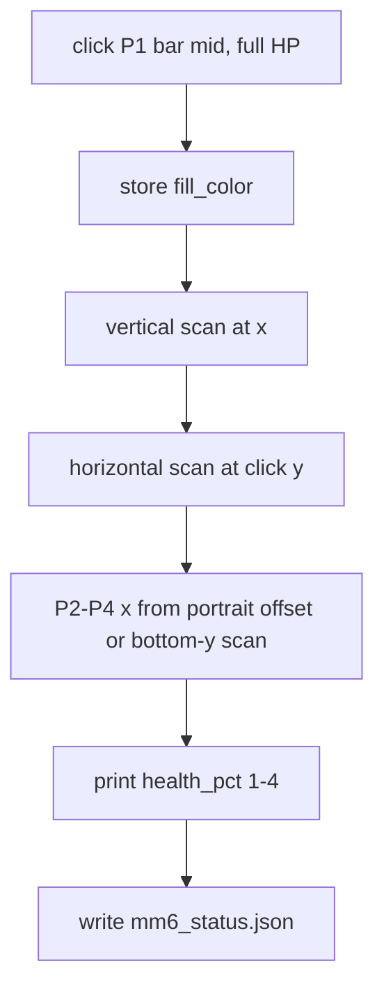

# MM6 healthbar status

## Status file

Replace the portrait-only [remapper/mm6_unselected.json](remapper/mm6_unselected.json) with a generalized [remapper/mm6_status.json](remapper/mm6_status.json) (underscore, same family as `mm6_bookcasts.json`). Shared bar geometry lives once; each player keeps unselected pixel + bar `x`.

```json
{
  "healthbar": {
    "fill_color": [r, g, b],
    "y_top": 1100,
    "y_bottom": 1180,
    "width": 8
  },
  "players": {
    "1": {
      "unselected": { "x": 474, "y": 1138, "color": [90, 85, 82] },
      "healthbar_x": 520
    }
  }
}
```

Screen y grows downward: `y_top` is the spec’s “lowest y still fill-colored” (full-health end); `y_bottom` is the “highest y still fill-colored” (empty end). `healthbar_x` is the horizontal center of that player’s bar.

`capture-healthbar.py` copies existing unselected samples into `players.*.unselected` when it writes the file. [remapper/mm6.py](remapper/mm6.py) reads `mm6_status.json` first and falls back to `mm6_unselected.json` for portraits only if status is missing (so bookcast skip-select keeps working before you run the new capture). Do not delete [remapper/capture-unselected.py](remapper/capture-unselected.py) in this pass.

## Throwaway capture: [remapper/capture-healthbar.py](remapper/capture-healthbar.py)

Same click loop as `capture-unselected.py` (GetAsyncKeyState, `get_mouse_pos` / `get_pixel_color`, Esc cancels). One click, then algorithm. Use `color.default_tolerance` from [settings.toml](settings.toml) (optional override later). **Do not run this script here**; you click player 1’s full bar yourself.

From the click `(x, y)` with P1 at full health:

1. Store `fill_color`.
2. Scan `y` up then down at that `x` while pixels stay similar to `fill_color` → `y_top`, `y_bottom`, `height`.
3. Scan `x` left/right at the click `y` (bar is full, so the whole width is fill-colored) → `width` and P1 center.

**Other three bars (proposal to implement):** do not require P2–P4 at full health. Mid-bar horizontal search would miss a depleted bar. Instead:

- Prefer **portrait offset** from unselected data you already captured. Portraits are ~339px apart (`474, 814, 1153, 1491`). `offset = p1_healthbar_x - portrait_1.x`; then `pN.healthbar_x = portrait_N.x + offset`. Nudge ±`width` to the nearest column that still matches `fill_color` at `y_bottom - 1` (bottom of the bar stays filled until HP is nearly gone).
- If unselected data is missing: walk right from P1 at `y_bottom - 1` looking for runs of `fill_color`, take the next three clusters whose run length is near `width`.
- If a candidate cannot be verified, still store the offset `x` and print a warning.

Print P1 geometry, the four `healthbar_x` values, and a one-shot `%` for each player (see below) so you can confirm before restarting remapper. Write `mm6_status.json` and exit.



## Remaining-health percent

No empty-color sample is required (P1 is full, so the depleted color is never seen). For player `n`:

- Read the column at `healthbar_x` from `y_top` through `y_bottom` (inclusive).
- `pct = 100 * (pixels similar to fill_color) / height`.

This is independent of whether the bar drains from the top or the bottom. Use the same SSD tolerance as capture.

On mm6 load, `PIXELS.register_points` for every `(healthbar_x, y)` in the four columns so a percent read is one mss grab, not one GDI round-trip per pixel ([pxl_lib.py](pxl_lib.py) `PixelSource`).

## Plugin API ([remapper/mm6.py](remapper/mm6.py))

- `_load_status()` fills `self.unselected` (existing caster-skip) plus `self.healthbar` / per-player `healthbar_x`.
- `health_pct(player) -> float | None` for `"1"`–`"4"`; `None` if bar data is missing.
- On startup, if bars are loaded, print the four percents once (verification after you restart remapper). Do not hook this into DEFINE/EXECUTE yet.

## Validate (you run)

```powershell
.pxlenv\Scripts\python.exe remapper\capture-healthbar.py
```

Click the bright midpoint of player 1’s **full** healthbar. Confirm the printed `%` for player 1 is ~100 and the other three look plausible. Restart remapper; startup log should show the same four percents and unselected skip-select still works.
